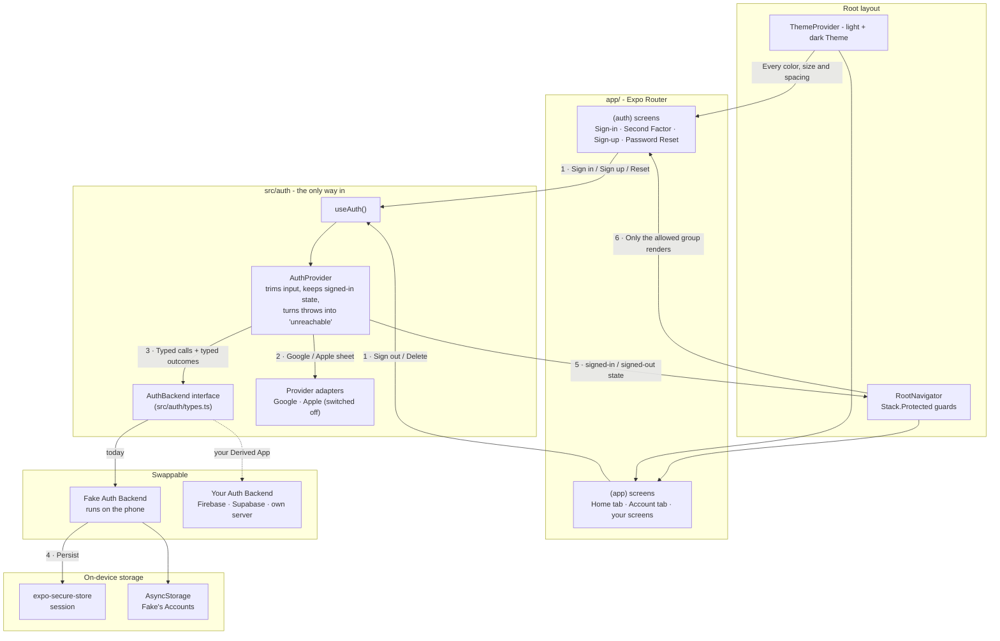
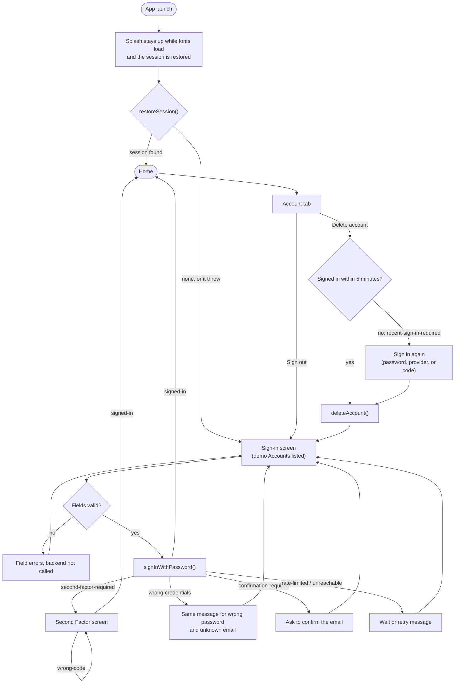

# 📱 Mobile App Starter — A Copyable Expo App With Real Account Flows

[](https://expo.dev/)
[](https://reactnative.dev/)
[](https://react.dev/)
[](https://www.typescriptlang.org/)
[](https://docs.expo.dev/router/introduction/)
[](tests/flows)
[](https://callstack.github.io/react-native-testing-library/)
[](docs/hand-check.md)
[](docs/building-on-the-starter.md#known-unproven-areas)
[](LICENSE)

A working Expo app for Android and iOS that exists to be **copied**. Out of the box it has every
account flow a real app needs: **Password Sign-in**, a **Second Factor** step, **Sign-up**,
**Password Reset** and **Account Deletion** with a recent-Sign-in check, plus a signed-in **Home**
and **Account Screen** to build on. Screens never talk to a backend directly. They go through one
narrow **Auth Backend seam**, and the Starter ships with a **Fake Auth Backend**, so the whole app
runs, and is tested, before any real service exists. One command, `npm run new-app`, turns a copy
into a **Derived App** with its own App Identity and a fresh git history.

## 🎬 Demo

[](#-demo)

*Placeholder: the demo video link will go here.*

See [GLOSSARY.md](GLOSSARY.md) for the project's vocabulary,
[docs/adr/](docs/adr/) for the two architecture decisions,
[docs/building-on-the-starter.md](docs/building-on-the-starter.md) for turning a copy into your own
app, and [docs/hand-check.md](docs/hand-check.md) for the 25-step Android checklist.

Architecture & Development: Burhan Saadi - October 2026

----

## 📐 Architecture & Flow

Screens ask `useAuth()` for everything. `AuthProvider` is the only code that reaches the Auth
Backend, and the Auth Backend is an interface, so the Fake can be swapped for Firebase Auth,
Supabase or your own server without touching a screen.



### Sign-in, step by step



---

## ✨ Key Features

* **🔐 Every Account Flow, Working** — Password Sign-in, Second Factor, Sign-up, Password Reset,
  Sign-out and Account Deletion are real screens with real error handling, not stubs. A session
  survives an app restart.
* **🔌 One Auth Backend Seam** — Screens use `useAuth()`; only `AuthProvider` reaches the backend,
  and the backend is the [`AuthBackend`](src/auth/types.ts) interface. Plugging in Firebase Auth,
  Supabase or your own server means implementing nine methods and changing one export.
* **🎭 A Fake That Behaves Like a Real Service** — The [Fake Auth Backend](src/auth/fake/createFakeAuthBackend.ts)
  needs no setup, yet it issues Second Factor challenges, enforces a recent Sign-in before Account
  Deletion, and "sends" a Password Reset that never reveals whether an email has an Account.
* **🧾 Outcomes Shaped by Real Services** — Results such as `confirmation-required` (Supabase),
  `recent-sign-in-required` (Firebase) and `rate-limited` (HTTP 429) are already handled on screen,
  so a real backend only has to map its responses.
* **🛡️ Protected Routes by Construction** — [`RootNavigator`](src/navigation/RootNavigator.tsx)
  uses `Stack.Protected`: anything under `app/(app)/` is unreachable while signed out, deep links
  included. A test proves a newly added screen stays locked.
* **👆 No Double Submits** — Buttons ignore presses while their action runs, and the keyboard's
  submit shares the same guard. Tapping **Sign in** twice sends one request.
* **🎨 One Theme, Enforced** — Every color, font size and spacing value comes from the
  [Theme](src/theme/theme.ts), in light and dark. A test fails the build if a screen uses a raw
  value, and a contrast test keeps text at 4.5:1 or better in both modes.
* **♿ Accessible Defaults** — Tap targets are 48dp on Android and 44pt on iOS, every field has a
  visible label that also names the input, and text wraps at the largest system font size.
* **🧬 One-Command Derived Apps** — `npm run new-app` copies the Starter, sets the whole App
  Identity, starts a fresh git history, removes itself, and **refuses to finish** if anything in the
  copy still identifies it as the Starter.
* **🧱 No Hand-Edited Native Code** — `ios/` and `android/` are generated from
  [app.config.ts](app.config.ts), so renaming an app or adding Google and Apple Sign-in are config
  changes, not Xcode and Gradle surgery ([ADR 0001](docs/adr/0001-expo-with-generated-native-folders.md)).

---

## 📂 Repository Structure

```
mobile-app-starter/
├── app/                              # Expo Router routes
│   ├── _layout.tsx                   # Root: ThemeProvider → AuthProvider → RootNavigator, splash
│   ├── (auth)/                       # Signed-out screens
│   │   ├── sign-in.tsx               # Password Sign-in + Google/Apple buttons + demo Accounts
│   │   ├── second-factor.tsx         # One-time code after a correct password
│   │   ├── sign-up.tsx               # Create an Account
│   │   └── password-reset.tsx        # "If an account exists…" reset request
│   └── (app)/                        # Signed-in only — guarded by Stack.Protected
│       ├── _layout.tsx               # Signed-in stack; your pushed screens go here
│       └── (tabs)/
│           ├── index.tsx             # Home — the placeholder for your app's content
│           └── account.tsx           # Account Screen: sign out, Account Deletion
├── src/
│   ├── auth/
│   │   ├── types.ts                  # The AuthBackend seam: methods + typed outcomes
│   │   ├── backend.ts                # The one line that picks which Auth Backend runs
│   │   ├── AuthProvider.tsx          # The only code that reaches the backend; useAuth()
│   │   ├── fake/                     # Fake Auth Backend + demo Accounts
│   │   ├── providers/                # Google and Apple native sign-in adapters
│   │   ├── sign-in-methods.ts        # Which Sign-in Methods this platform offers
│   │   ├── storage.ts                # KeyValueStore interface
│   │   ├── device-storage.ts         # SecureStore + AsyncStorage adapters
│   │   ├── validation.ts             # Email and required-field checks
│   │   ├── password-rules.ts         # MIN_PASSWORD_LENGTH — keep in step with your backend
│   │   └── messages.ts               # Every on-screen auth message in one place
│   ├── features/
│   │   ├── auth/                     # DemoAccountsHint · ProviderButtons
│   │   └── account/                  # ReauthPrompt — sign in again before deleting
│   ├── navigation/RootNavigator.tsx  # Signed-in vs signed-out route groups
│   ├── theme/                        # Theme (light + dark), fonts, contrast, ThemeProvider
│   ├── ui/                           # AppText · Button · TextField · FormMessage · Screen · useSubmit
│   └── test-utils/                   # renderApp, test backend, raw-style scanner
├── tests/flows/                      # End-to-end flows through the real routes
├── scripts/
│   ├── new-app.js                    # The new-app command
│   ├── setup-windows.ps1             # What setup-windows.cmd runs
│   └── run-android.js                # What run-android.cmd runs
├── setup-windows.cmd                 # Windows: install everything the emulator run needs
├── run-android.cmd                   # Windows: start the emulator, build and open the app
├── assets/                           # App icon, adaptive icon layers, splash
├── docs/
│   ├── adr/                          # 0001 Expo + generated native folders · 0002 one Theme
│   ├── building-on-the-starter.md    # Copied into every Derived App
│   ├── hand-check.md                 # 25-step Android checklist, light and dark
│   └── agents/                       # Conventions for Claude Code (issues, domain docs)
├── app.config.ts                     # Expo config built from the App Identity + Sign-in Methods
├── app-identity.json                 # Name, slug, scheme, bundle ID, package name
├── GLOSSARY.md                       # The project's vocabulary
├── LICENSE                           # MIT License
└── README.md                         # Project presentation (This file)
```

---

## 🚀 Getting Started

### On Windows: two commands

From the project folder, in Command Prompt or PowerShell:

```sh
setup-windows.cmd     # once per machine
run-android.cmd       # every time you want the app running
```

* **`setup-windows.cmd`** installs everything below that's missing: Node.js, git and JDK 17 with
  winget, then the Android SDK (no Android Studio needed), the emulator, CMake 3.31 and a virtual
  device. It turns on Windows long paths and the emulator's hardware acceleration after one
  administrator prompt, sets `ANDROID_HOME` and `JAVA_HOME`, and runs `npm install`. It's safe to
  run again. Open a new terminal afterwards if it installed anything.
* **`run-android.cmd`** checks the machine, runs `npm install` when `package-lock.json` changed,
  starts the emulator when no device is attached, generates `android/` with the long-path fix
  applied, then builds, installs and opens the app, and leaves Metro running for live reloads.
  `--check` only lists what's missing, `--clean` regenerates `android/` (after changing
  `app.config.ts`), and `--avd <name>` picks the emulator.
* **"System UI isn't responding"** on a freshly started emulator during the first build is the
  emulator struggling under the build's load, not the app. Tap **Wait**.

### Prerequisites

* **Node.js** `^22.13`, `^24.3` or `>=26`, and **git**.
* **The Android SDK**, from Android Studio or the command-line tools, plus an emulator or an
  Android phone with USB debugging on.
* `ANDROID_HOME` set (usually `%LOCALAPPDATA%\Android\Sdk`). Add `%ANDROID_HOME%\platform-tools` to
  `PATH` if you want to type `adb` yourself.
* **JDK 17**, with `JAVA_HOME` pointing to it.
* **Windows only:** CMake 3.31 or newer from the SDK, and Windows long paths turned on. See
  [the long-path fix](docs/building-on-the-starter.md#windows-native-build-fails-with-a-long-path).
* **iOS** needs a Mac, or a cloud build service such as EAS Build plus a paid Apple Developer
  Program membership.
* No backend, database or API key. The Fake Auth Backend runs on the phone.

### Run on Android by hand

1. **Install dependencies:**
   ```sh
   npm install
   ```

2. **Build and install the development build:**
   ```sh
   npx expo run:android
   ```
   *The first run takes several minutes and installs the app on the running emulator or connected
   phone. Expo Go isn't supported. Use the development build.*

3. **Iterate:**
   ```sh
   npx expo start
   ```
   *Reloads your changes into the installed development build.*

4. **Sign in** with `demo@example.com` / `Password123!`. The sign-in screen lists both demo Accounts.

> **Native build fails on Windows with `ninja: error: mkdir(...)`?** The build paths passed
> Windows' 260-character limit. `run-android.cmd` applies the fix for you; by hand, install CMake
> 3.31+, turn on long paths, and point `android/local.properties` at that CMake. The steps are in
> [building-on-the-starter.md](docs/building-on-the-starter.md#windows-native-build-fails-with-a-long-path).

### Create a Derived App

```sh
npm run new-app -- --name "FitTrack" --id com.yourname.fittrack
```

* **`--id`** becomes both the iOS bundle ID and the Android package name: at least two dot-separated
  parts, each starting with a letter, letters and numbers only, no Java reserved words.
* **Where it goes:** a sibling folder named after the slug (here `../fittrack`), unless you pass
  `--dir`. Pass `--slug` to choose the slug yourself.
* **What it does:** sets the App Identity (name, slug, URL scheme, bundle ID, package name), starts
  a fresh git history, removes itself from the copy, fails if anything still identifies the copy as
  the Starter, and prints a to-do list: icons, Theme, keys and Auth Backend.
* **Not copied:** the Starter's own plans and issues (`docs/superpowers/`, `.scratch/`), local keys
  (`.env*.local`), and build output.

---

## 🧩 The Building Blocks

| Block | Job | Lives in | A Derived App… |
| :--- | :--- | :--- | :--- |
| **App Identity** | Name, slug, scheme, bundle ID, package name | `app-identity.json` | Gets its own from `npm run new-app` |
| **Auth Backend seam** | Typed methods and outcomes every backend speaks | `src/auth/types.ts` | Implements it for its real service |
| **Fake Auth Backend** | A working backend on the phone, with demo Accounts | `src/auth/fake/` | Replaces it in `src/auth/backend.ts` |
| **AuthProvider** | The only caller of the backend; trims input, owns signed-in state | `src/auth/AuthProvider.tsx` | Keeps it unchanged |
| **Sign-in Methods** | Which of Password, Google and Apple are offered | `app.config.ts` | Switches Google or Apple on |
| **RootNavigator** | Shows `(auth)` or `(app)`, never both | `src/navigation/` | Keeps it unchanged |
| **Theme** | Every color, font, size and spacing value, light and dark | `src/theme/` | Replaces the values from its Reference Design |
| **UI blocks** | Text, buttons, fields, messages, screen frame, submit guard | `src/ui/` | Builds new screens from them |

**Screens ask; the provider decides.** No screen imports a backend. Everything goes through
`useAuth()`, which is why the same screens run against the Fake, the test backend, and whatever
real service a Derived App plugs in.

**Throws become "unreachable".** If a backend or a provider throws, `AuthProvider` logs the real
error in development (`[auth] <action> failed` in the Metro log) and the person sees "couldn't reach
the server". The app never crashes on a backend error.

**Identity checks are deliberately strict.** `new-app` scans every text file in the copy for the
Starter's name, slug, scheme and IDs, and stops before creating git history if any remain. When the
Starter gains something that carries its identity, `scripts/new-app.js` must learn about it too.

---

## 🔑 Configuration

Everything is configured in [app.config.ts](app.config.ts), [app-identity.json](app-identity.json)
and an optional `.env.local` (git-ignored). No native project files are edited by hand.

### Sign-in Methods

| Method | Default | Switch on in | Also needs |
| :--- | :--- | :--- | :--- |
| **Password** | ✅ On | — | Nothing |
| Google | Off | `signInMethods.google = true` | Google Cloud OAuth clients + `.env.local` keys, then a rebuild |
| Apple | Off | `signInMethods.apple = true` | A paid Apple Developer Program membership; the button only appears on iPhone |

> **App Store rule 4.8.** An iOS app that offers Google must also offer an equivalent
> privacy-focused option, usually Sign in with Apple. The Fake accepts any Google or Apple identity
> without checking it. Your real Auth Backend must verify the ID token.

### Environment variable reference

| Variable | Required? | Default | Purpose |
| :--- | :--- | :--- | :--- |
| `EXPO_PUBLIC_GOOGLE_WEB_CLIENT_ID` | Only with Google on | *(empty)* | Google Web OAuth client ID; the config refuses to build without it when Google is on |
| `GOOGLE_IOS_URL_SCHEME` | Only for Google on iPhone | *(empty)* | Reversed iOS client ID; the iOS client ID is derived from it |

Put them in `.env.local` at the project root, then rebuild with `npx expo run:android`, because the
native configuration changed. The full walkthrough, including finding your debug SHA-1, is in
[building-on-the-starter.md](docs/building-on-the-starter.md#switch-on-google-or-apple).

---

## 🗃️ Demo Data

While the Fake Auth Backend is active, these Accounts work and the sign-in screen lists them:

| Email | Password | Second Factor code |
| :--- | :--- | :--- |
| `demo@example.com` | `Password123!` | none |
| `demo-2fa@example.com` | `Password123!` | `123456` |

* **Your own Accounts** created with Sign-up are stored on the phone and survive restarts.
* **Deleted demo Accounts** come back on the next launch.
* **Recent Sign-in** lasts 5 minutes. After that, Account Deletion asks you to sign in again, and the
  2FA demo Account must enter its code again too.
* **Email case and spaces** don't matter: `Demo@Example.com ` is the same Account.

---

## 🎤 The Demo Walkthrough

A short tour of the app, taken from the [Android hand-check](docs/hand-check.md). Run
`npx expo run:android` first, and try it once in light mode and once in dark.

1. **Launch.** The splash holds until fonts and the session are ready, then shows Sign in with the
   demo Accounts box.
2. **Validation.** Tap **Sign in** with empty fields. Field errors appear and nothing is sent.
3. **Wrong password.** "That email and password don't match." The email stays filled in.
4. **Sign in.** `demo@example.com` / `Password123!`, tapped twice quickly: one spinner, and Home
   appears once.
5. **Restart.** Swipe the app away and reopen it. You're still signed in.
6. **Second Factor.** Sign out, then sign in as `demo-2fa@example.com`. Enter `000000` to see the
   error, then `123456` to reach Home.
7. **Sign-up and Password Reset.** Create an Account (the 8-character rule shows under Password),
   then request a reset for a known and an unknown email. Both show the same message.
8. **Account Deletion.** Delete a fresh Account straight away. Then make another, wait 5 minutes,
   and delete it. You're asked to sign in again first.

> **Look and feel worth showing:** every screen in dark mode, the largest system font size (text
> wraps, nothing is cut off), and the tab bar and status bar clearing the camera cutout and gesture
> bar.

---

## 🔎 How the Auth Backend Is Wired

* **Pick.** [`src/auth/backend.ts`](src/auth/backend.ts) exports `authBackend`, which today is the
  Fake, storing Accounts in AsyncStorage and the session in SecureStore. It also exports
  `demoAccounts`; set it to `null` once a real backend is in.
* **Provide.** [`app/_layout.tsx`](app/_layout.tsx) passes the backend, the Google and Apple
  adapters and the enabled Sign-in Methods into `AuthProvider`.
* **Restore.** On launch `AuthProvider` calls `restoreSession()`. The state goes from `loading` to
  `signed-in` or `signed-out`, and the splash hides only when it's no longer loading.
* **Act.** Screens call `useAuth()`. Emails and codes are trimmed before they reach the backend, and
  anything thrown becomes `unreachable`.
* **Route.** `RootNavigator` renders `(app)` only when signed in and `(auth)` only when signed out,
  redirecting to `/sign-in` or `/` as the state changes.

### AuthBackend reference

| Method | Returns | Notes |
| :--- | :--- | :--- |
| `restoreSession()` | `Session \| null` | Called once at launch |
| `signUp(email, password)` | `signed-in` · `confirmation-required` · `email-in-use` · `weak-password` | |
| `signInWithPassword(email, password)` | `signed-in` · `second-factor-required` · `confirmation-required` · `wrong-credentials` | Same `wrong-credentials` for a bad password and an unknown email |
| `submitSecondFactor(challengeId, code)` | `signed-in` · `wrong-code` | Answers challenges from Sign-in and from `reauthenticate` |
| `signInWithProvider(identity)` | `signed-in` | Google and Apple never ask for a Second Factor |
| `requestPasswordReset(email)` | `sent` | Same answer whether or not the Account exists |
| `reauthenticate(proof)` | `signed-in` · `second-factor-required` · `wrong-credentials` | A fresh `signedInAt` for Account Deletion |
| `deleteAccount()` | `deleted` · `recent-sign-in-required` | Acts on the current session |
| `signOut()` | `void` | `AuthProvider` also signs out of Google, so the next person can pick another account |

Every method except `restoreSession` and `signOut` can also return `unreachable` (no network,
timeout) or `rate-limited` (too many attempts). The mapping from Firebase and Supabase responses is
in [building-on-the-starter.md](docs/building-on-the-starter.md#plug-in-a-real-auth-backend).

---

## 🎨 Theme

One named set of colors, fonts, text sizes and spacing, in light and dark, that every screen takes
its look from ([ADR 0002](docs/adr/0002-built-in-styling-with-one-theme.md)).

* **Built-in, no styling library.** React Native `StyleSheet` plus a Theme read from `useTheme()`.
  NativeWind and component kits like React Native Paper or Tamagui were considered and rejected.
* **Enforced by a test.** [`no-raw-style-values.test.ts`](src/theme/no-raw-style-values.test.ts)
  fails if a screen hard-codes a color, font size or spacing value.
* **Readable in both modes.** [`theme.test.ts`](src/theme/theme.test.ts) checks that text stays
  readable (WCAG 4.5:1 contrast) in light and dark, and that both Themes have the same shape.
* **Restyling is two files.** Hand Claude Code a screenshot or Figma file (a Reference Design) and
  ask it to extract the Theme into `src/theme/theme.ts` and `src/theme/fonts.ts`. Every screen
  follows.

The default Theme is a slate palette with IBM Plex Sans, a 4 / 8 / 16 / 24 / 32 spacing scale, and
tap targets of 48dp on Android and 44pt on iOS.

---

## 🧪 Tests

```sh
npm test               # 122 tests, every account flow against the Fake; no emulator needed
npm run typecheck      # tsc --noEmit, strict
npm run test:new-app   # slow: creates a Derived App, installs it and runs its own tests
```

The flow tests render the **real routes** with a test Auth Backend, so they exercise navigation,
guards and screens together.

| File | Covers |
| :--- | :--- |
| [sign-in.test.tsx](tests/flows/sign-in.test.tsx) | Demo Accounts listed, field errors, wrong password, Second Factor, one request per double tap or keyboard submit, restart, Google on/off/cancel, unconfirmed email, rate limits |
| [sign-up.test.tsx](tests/flows/sign-up.test.tsx) | Creating an Account, email in use, the password rule, email confirmation |
| [password-reset.test.tsx](tests/flows/password-reset.test.tsx) | Empty email, back to Sign-in, one email per double submit |
| [account.test.tsx](tests/flows/account.test.tsx) | Sign-out across restarts, cancelled and confirmed Account Deletion, sign in again when old, Google and 2FA re-checks, unreachable server |
| [screens.test.tsx](tests/flows/screens.test.tsx) | A new `(app)` screen is locked while signed out and opens when signed in |
| [AuthProvider.test.tsx](src/auth/AuthProvider.test.tsx) | Session restore, throws → `unreachable`, trimming, development logging, Google cancel |
| [createFakeAuthBackend.test.ts](src/auth/fake/createFakeAuthBackend.test.ts) | The Fake's rules: same error for bad password and unknown email, email case, challenges, Sign-up, reset, recent Sign-in |
| [theme.test.ts](src/theme/theme.test.ts) · [no-raw-style-values.test.ts](src/theme/no-raw-style-values.test.ts) | Contrast in light and dark; screens use only Theme values |
| [Button.test.tsx](src/ui/Button.test.tsx) · [TextField.test.tsx](src/ui/TextField.test.tsx) | Press guard while busy, disabled state, labels and errors |
| [app.config.test.ts](app.config.test.ts) | App Identity, Google key checks and iOS client ID, Apple plugin, light/dark system UI |
| [new-app.test.js](scripts/new-app.test.js) · [new-app.e2e.test.js](scripts/new-app.e2e.test.js) | Identity derivation, refusing bad folders and IDs, no Starter identity left, a Derived App that installs and passes its own tests |

Before calling a change done on a device, work through [docs/hand-check.md](docs/hand-check.md) on
Android: 25 steps, twice (light and dark).

---

## 🚢 Production Notes

* **Swap the Fake before you ship.** Implement `AuthBackend` on Firebase Auth, Supabase or your own
  server, export it from `src/auth/backend.ts`, and set `demoAccounts` to `null`. Never connect the
  app straight to a database: its password would ship inside the app.
* **Verify provider tokens server-side.** The Fake trusts any Google or Apple identity. A real
  backend must verify the ID token.
* **Keep the password rule in step.** `MIN_PASSWORD_LENGTH` in `src/auth/password-rules.ts` drives
  the Sign-up hint. Match it to your backend's rule.
* **Generated native folders.** `ios/` and `android/` are build output and git-ignored. Change
  `app.config.ts` or a config plugin, never the generated folders.
* **Development builds only.** Once Google Sign-in is in, Expo Go can't run the app.
* **Expo SDK.** Each Derived App inherits the SDK that was current when it was copied, and upgrades
  on its own schedule.
* **Known unproven areas.** iOS is configured but has never been built or run. Google Sign-in is
  covered by automated tests with a stand-in but has never run against Google. The seam has only
  run against the Fake. A Derived App inherits these until it proves them.
* **Not built, by design.** Account linking across Sign-in Methods, lockouts in the Fake, a guard
  against shipping the Fake, and real Auth Backend adapters.

---

## 📄 License

Copyright 2026 **Burhan Saadi**. Licensed under the [MIT License](LICENSE).

You're free to use, copy, modify, merge, publish, distribute, sublicense and sell this project,
including commercially, and to build your own apps from it. The one condition: **keep the copyright
notice and the [LICENSE](LICENSE) text** in any copy or substantial portion you share. Derived Apps
created with `npm run new-app` carry the LICENSE file with them for this reason.

**No warranty, no liability.** The software is provided **"as is"**, without warranty of any kind.
The author is not liable for any claim, damages or other liability arising from its use. You're
responsible for:

* testing it before you rely on it;
* the Auth Backend you plug in, and the security of your users' Accounts and data;
* the keys, accounts and bills of any service you connect (Google Cloud, Apple Developer Program,
  Firebase, Supabase or others);
* meeting app store rules and the privacy and data-protection laws that apply to your users.

**Demo data only.** The demo Accounts, emails and codes are fictional and public. Don't reuse them
for real Accounts, and don't ship a Derived App with the Fake Auth Backend switched on.
